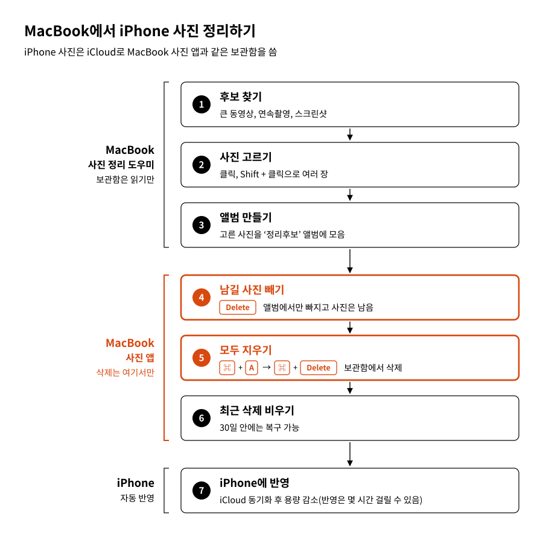

# 사진 정리 도우미

MacBook 사진 앱의 보관함(iCloud 사진)을 읽어 지울 만한 후보를 브라우저 화면으로 보여 주는 도구입니다. 실제 삭제는 사용자가 사진 앱에서 직접 합니다. iCloud 사진을 쓰면 iPhone과 같은 보관함이므로 정리 결과가 iPhone에도 반영됩니다.

## 기능

- 대용량, 연속촬영, 버스트 미선택, 스크린샷의 네 기준으로 후보를 찾습니다.
- 촬영 기간을 정하고, 용량순으로 보되 비슷한 시간대끼리 묶어 볼 수 있습니다.
- 고른 항목은 사진 앱 앨범으로 만들거나, 원본 복사 또는 CSV로 저장할 수 있습니다.

## 안전 원칙

- 보관함 데이터베이스는 읽기 전용으로만 엽니다.
- 삭제 기능이 없습니다. 보관함에 쓰는 동작은 ‘앨범 만들기’ 하나뿐입니다.
- 화면은 이 컴퓨터(127.0.0.1)에서만 열리며 데이터를 외부로 보내지 않습니다.

## 실행

필요한 것은 macOS와 python3입니다. 별도 패키지는 없습니다.

1. 저장소를 내려받습니다.
2. 시스템 설정 > 개인정보 보호 및 보안 > 전체 디스크 접근 권한에서 ‘터미널’을 켭니다.
3. `사진정리도우미 실행.command`를 더블클릭합니다. 경고가 나오면 우클릭 > 열기로 엽니다.
4. 브라우저에 열린 화면의 **사용 안내**에서 삭제 방법을 확인합니다.

터미널에서는 `python3 photo_review.py`로 실행합니다.

## 주의

- 사진 앱의 데이터베이스 구조는 비공개 형식이라 macOS 업데이트 후 동작하지 않을 수 있습니다.
- ‘앨범 만들기’와 ‘원본 내보내기’는 충분히 시험하지 않았으니 처음에는 몇 장으로 확인하세요.
- Apple과 관계없는 개인 도구이며, 삭제는 사용자의 판단과 책임으로 진행합니다.

## 라이선스

MIT License ([LICENSE](LICENSE))
